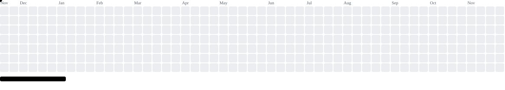

# 👾 Hi, I'm Luqman!

**Curious about data, databases, and building useful web projects.**

---

### 👨‍💻 About Me

- 🎯 **Career interest:** Data Analysis
- 🌱 **Currently learning:** Python, SQL, web technologies, and database fundamentals
- 📍 **Based in:** Padang, Indonesia
- 💻 **What I enjoy:** Building projects, exploring data, and learning by experimenting

### 🛠️ Tech Stack & Tools I'm Exploring

  

> Some tools are still part of my learning journey this section does not imply expert proficiency.

### 💼 Experience & Learning Journey

| Focus | What I'm Working On |
| --- | --- |
| 📊 Data & SQL | Data preparation, basic analysis, and database queries |
| 🌐 Web development | Small web projects and responsive interfaces |
| 🗃️ Databases | Modeling and querying structured data |

### 🚀 Featured Project

**🌐 [Porto](https://github.com/akimmstar/Porto)**
**🌐 [ProgCashier](https://github.com/akimmstar/ProgCashier)**

**🌐 [Tamantulipp](https://github.com/akimmstar/Tamantulipp)**

---

### 📊 GitHub Analytics

**⚡ Coding Statistics & Most Used Languages**

**🔥 Contribution Streak**

**📈 Contribution Activity (Last 31 Days)**

> 📌 Language percentages reflect code detected in eligible GitHub repositories, not skill proficiency. Third-party stat cards may load slowly or temporarily reach rate limits.

---

### 🎮 My Contribution Arcade

**👻 Pac-Man eats my contribution graph**

<picture>
  <source media="(prefers-color-scheme: dark)" srcset="https://raw.githubusercontent.com/akimmstar/akimmstar/output/pacman-contribution-graph-dark.svg" />
  <source media="(prefers-color-scheme: light)" srcset="https://raw.githubusercontent.com/akimmstar/akimmstar/output/pacman-contribution-graph.svg" />
  
</picture>

**🧱 Breakout destroys the contributions**

<picture>
  <source media="(prefers-color-scheme: dark)" srcset="https://raw.githubusercontent.com/akimmstar/akimmstar/output/breakout-contribution-graph-dark.svg" />
  <source media="(prefers-color-scheme: light)" srcset="https://raw.githubusercontent.com/akimmstar/akimmstar/output/breakout-contribution-graph.svg" />
  
</picture>

🐍 Bonus: Snake Contribution Animation

<picture>
  <source media="(prefers-color-scheme: dark)" srcset="https://raw.githubusercontent.com/akimmstar/akimmstar/output/github-contribution-grid-snake-dark.svg" />
  <source media="(prefers-color-scheme: light)" srcset="https://raw.githubusercontent.com/akimmstar/akimmstar/output/github-contribution-grid-snake.svg" />
  
</picture>

---

### 🕹️ Want to play instead of just watching?

**[PLAY SNAKE & MEMORY MATCH 🎮](https://akimmstar.github.io/akimmstar/)**

*Two interactive games with keyboard and mobile support. Hosted by GitHub Pages.*

✨ **Always learning. Always building.** ✨

